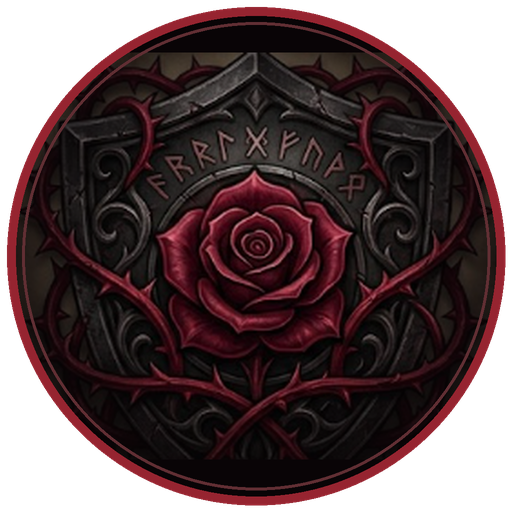

<p align="center">
  
</p>

<h1 align="center">Grimoire Launcher</h1>

<p align="center">
  Un launcher de juegos de escritorio con estética dark fantasy.<br>
  Steam, Epic, juegos sueltos y ROMs en una sola biblioteca.
</p>

<p align="center">
  
  
  
  
</p>

---

Grimoire junta todo lo que juegas en una ventana que apetece abrir: portadas,
horas jugadas, último guardado, logros, notas y etiquetas tuyas. Todo se guarda
en local, sin cuentas ni servidores propios.

Hecho con **Tauri v2 + React + TypeScript** en el frontend y **Rust** en el
backend.

## Qué hace

### Biblioteca

- **Escaneo de Steam** con **horas reales**: lee `localconfig.vdf` y muestra
  las horas y la última partida que Steam ya tiene registradas, desde el primer
  momento.
- **Escaneo de Epic** (Windows): parsea los manifiestos `.item`.
- **Juegos externos**: cualquier `.exe` fuera de Steam/Epic (portables,
  instalados a mano), con su portada y su carpeta de saves. Se pueden lanzar
  **como administrador** (UAC).
- **Portadas automáticas**: primero la caché local de Steam y, si falta, la
  portada y el banner *hero* desde la CDN. También admite portadas propias.
- **Metadata de Steam**: géneros, desarrollador, fecha y descripción.
- **Cronómetro** propio para los juegos externos y **último guardado**
  vigilando la carpeta de saves.
- **Estado, notas y etiquetas** por juego, con filtros, búsqueda y orden por
  recién jugado, horas o nombre.
- **Juegos fantasma**: detecta los juegos de Steam cuya carpeta ya no existe y
  propone apartarlos en bloque. No borra nada por su cuenta.

### Platinos

- Conecta tu cuenta con una **API key de Steam** (la introduces tú en la app;
  no va en el código) y sincroniza los logros de cada juego.
- Si tienes todos los logros, el juego se marca como **platino**
  automáticamente. También se puede marcar a mano.

### Estadísticas

- Juegos más jugados, horas por día y a qué horas sueles jugar, a partir del
  historial de sesiones.

### Emuladores

- Asigna un emulador por sistema (**Game Boy, GBA y DS**), añade tus ROMs y
  lánzalas desde Grimoire con su propio contador de horas y portada.

### Copia de seguridad

- **Exporta e importa** tus datos (estados, notas, etiquetas, platinos y
  portadas) en un JSON. Un re-escaneo nunca pisa lo que has editado tú.

## Estética

La identidad visual nace del sello: una rosa de sangre sobre un escudo rúnico
de metal y obsidiana. La paleta sale directamente de esa imagen:

| Token | Color | Uso |
|-------|-------|-----|
| Obsidiana | `#0c0708` | Fondo, un negro cálido casi rojo |
| Sangre | `#a8313f` / `#c8434f` | El rojo de la rosa, acento principal |
| Vino | `#6b222e` | Rojos profundos de sombra |
| Hierro / óxido | `#18100f` / `#3a2622` | Superficies y bordes |
| Hueso / plata | `#e6dcd0` / `#c3b5a8` | Textos |

- **Tipografía**: Cinzel para los títulos (inscripción tallada), Cormorant
  Garamond para los nombres de juego e IBM Plex Mono para los datos.
- **Ambiente**: una brasa de sangre que late desde abajo y espinas de fondo,
  con cinco temas (Brasa, Intenso, Ceniza, Sangre fría y Áureo).
- **Zarzas que crecen** al abrir un juego, trazadas en SVG con rosas en las
  puntas.
- **Sonidos sintéticos** con Web Audio API, sin ficheros de audio. Se pueden
  silenciar.

El icono del ejecutable es el propio sello.

## Requisitos

- **Node.js** 18+ y npm
- **Rust** (vía [rustup](https://rustup.rs))
- Las dependencias de sistema de Tauri para tu SO:
  <https://v2.tauri.app/start/prerequisites/>. En Windows: Microsoft C++ Build
  Tools y WebView2 (suele venir ya en Windows 11).

## Desarrollo

```bash
npm install
npm run tauri dev
```

La primera compilación de Rust tarda un rato. Después, el frontend se recarga
en caliente al instante.

## Compilar el ejecutable

```bash
npm run tauri build
```

El instalador queda en `src-tauri/target/release/bundle/`.

## Arquitectura

```
src/                        Frontend (React + TS)
  components/
    GameCard.tsx            La "carta del grimorio" del grid
    GameDrawer.tsx          Panel de detalle: jugar, stats, notas, tags
    AddGameModal.tsx        Alta de juegos externos
    PlatinumsView.tsx       Logros de Steam y platinos
    StatsView.tsx           Gráficas de horas y sesiones (Recharts)
    EmulatorsView.tsx       Emuladores y ROMs por sistema
    GrowingVines.tsx        Zarzas animadas al abrir un juego
    StatsBar.tsx            Resumen de la biblioteca
  lib/
    api.ts                  Wrapper de invoke() + cronómetro de sesión
    types.ts                Tipos espejo de los structs de Rust
    theme.ts                Temas de ambiente
    sound.ts                Sonidos sintéticos (Web Audio)
    stats.ts                Cálculo de estadísticas
    format.ts               Formato de tiempo y fechas en español
  App.tsx                   Orquestador y pestañas

src-tauri/                  Backend (Rust)
  src/
    lib.rs                  Comandos Tauri (#[tauri::command])
    models.rs               Game, Rom, Emulator, Source, Status
    db.rs                   Persistencia SQLite
    steam.rs                libraryfolders.vdf, appmanifest.acf y horas
    epic.rs                 Manifiestos de Epic
    enrich.rs               Portadas, hero y metadata de Steam
    achievements.rs         Logros vía la Steam Web API
    launcher.rs             Lanzar procesos/URIs y comprobar el PID
    saves.rs                Timestamp del save más reciente
    main.rs                 Punto de entrada
```

### Cómo identifica los juegos

| Fuente | Detección | Lanzamiento |
|--------|-----------|-------------|
| Steam | `libraryfolders.vdf` → `appmanifest_*.acf` | `steam://rungameid/<appid>` |
| Epic | Manifiestos `.item` en ProgramData | `com.epicgames.launcher://...` |
| Externo | El usuario apunta al `.exe` | Proceso directo |
| ROM | El usuario apunta a la ROM | Emulador asignado al sistema |

Los datos se guardan en SQLite (`%APPDATA%/grimoire-launcher/library.db` en
Windows) y las imágenes en una caché junto a ella.

## Notas técnicas

- Las **horas de Steam** se leen de `localconfig.vdf`, que Steam actualiza al
  cerrar sesión o salir. Grimoire toma siempre el máximo entre lo que reporta
  Steam y lo que ha cronometrado él.
- Las **imágenes** se sirven por el *asset protocol* de Tauri, habilitado en
  `tauri.conf.json` con un scope que cubre la carpeta de caché. Sin esa
  configuración el webview no las mostraría aunque estén descargadas.

## Pendiente

- Cronometrar en vivo los juegos de Steam mientras Grimoire está abierto.
- Detectar GOG y otros launchers.
- Buscador de portadas para los juegos externos.
